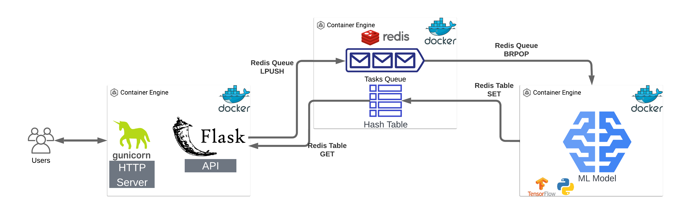
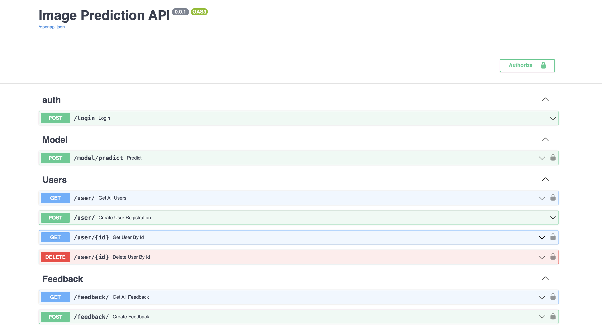
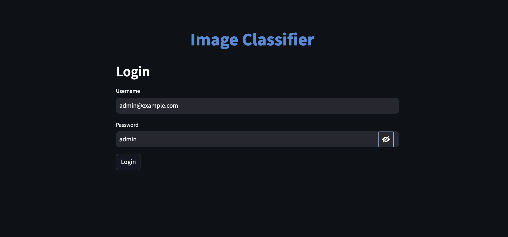
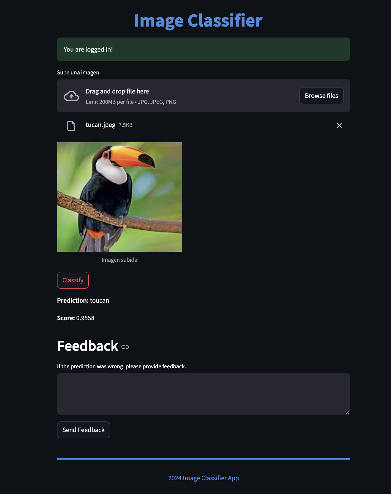

# 🖼️ Distributed Image Classification Microservices — FastAPI, Redis & TensorFlow


A decoupled, containerized **Machine Learning inference platform** that classifies uploaded images into over **1,000 ImageNet categories** using a pre-trained **Convolutional Neural Network (ResNet50)**. Built with a microservices architecture orchestrated via **Docker Compose**, it separates the web frontend, REST API gateway, asynchronous message queue, relational persistence, and deep learning worker process.

---

## 🏗️ System Architecture



### How It Works

1. **Web UI (`ui/` — Streamlit)**: Provides an interactive interface for user authentication, image upload, real-time classification results, and user feedback submission on model predictions.
2. **REST API (`api/` — FastAPI + SQLAlchemy)**:
   - Manages user registration, password hashing (`bcrypt`), and **OAuth2 / JWT (`HS256`)** bearer authentication.
   - Validates uploaded image formats, computes content-addressable **MD5 hashes** to deduplicate files on disk (`uploads/`), and enqueues inference jobs into **Redis**.
   - Polls Redis asynchronously (`API_SLEEP = 0.05s`) using a unique correlation `job_id` until the prediction result is ready.
   - Persists user accounts and model prediction feedback into **PostgreSQL**.
3. **Message Broker (`redis:6.2.6`)**: Decouples HTTP request handling from CPU/GPU-bound deep learning inference via a blocking FIFO queue (`service_queue` using `rpush` / `brpop`).
4. **ML Worker Service (`model/` — TensorFlow / Keras)**:
   - Continuously listens on the Redis queue (`brpop`), preprocesses each image (`224x224` target size, batch expansion, ImageNet normalization), runs **ResNet50** inference, and writes the predicted class and confidence score back to Redis keyed by `job_id`.
5. **Load & Stress Testing (`stress_test/` — Locust)**: Simulates concurrent users authenticating and submitting classification requests to benchmark throughput and latency under load.

---

## ✨ Key Features

- **🔐 JWT Security & User Management**: Full CRUD for users with `bcrypt` password hashing and OAuth2 Password Bearer JWT tokens (`30 min` expiration).
- **⚡ Asynchronous Queue-Based Inference**: Non-blocking FastAPI endpoints (`async/await`) communicating with a dedicated TensorFlow worker over Redis.
- **♻️ Content-Addressable Image Deduplication**: Uploaded images are renamed using their MD5 digest (`get_file_hash`), preventing redundant disk writes.
- **📊 Feedback Loop Storage**: Captures user feedback (`score`, `prediction`, `feedback` text, `image_file_name`) in PostgreSQL for future model retraining and auditing.
- **🐳 Multi-Stage Docker Builds**: Dedicated `test` and `build` targets across `api`, `model`, and `ui` Dockerfiles for isolated unit testing and lean runtime containers.

---

## 🖥️ Screenshots

### Interactive OpenAPI / Swagger Documentation (`/docs`)


### Streamlit Web Application — Authentication & Classification
| Login Screen | Image Classification & Feedback |
| :---: | :---: |
|  |  |

---

## 📁 Project Structure

```text
FastAPI-ML-App/
├── api/                              # FastAPI Backend Microservice
│   ├── app/
│   │   ├── auth/                     # OAuth2 / JWT token generation & verification
│   │   ├── feedback/                 # Feedback SQLAlchemy models, schemas & router
│   │   ├── model/                    # /model/predict endpoint & Redis queue producer
│   │   ├── user/                     # User CRUD, bcrypt hashing & validation
│   │   ├── db.py                     # SQLAlchemy engine & session management
│   │   ├── settings.py               # Environment-driven configuration
│   │   └── utils.py                  # File extension validation & MD5 hashing
│   ├── tests/                        # Pytest unit tests for routers & utilities
│   ├── Dockerfile                    # Multi-stage Dockerfile (test / build)
│   ├── main.py                       # FastAPI application entrypoint
│   └── populate_db.py                # Database initialization & seed script
├── model/                            # TensorFlow / Keras ML Worker Microservice
│   ├── tests/                        # Unit tests for ResNet50 inference worker
│   ├── Dockerfile                    # Multi-stage Dockerfile (x86_64)
│   ├── Dockerfile.M1                 # Apple Silicon (ARM64) Dockerfile
│   └── ml_service.py                 # Redis consumer & ResNet50 prediction loop
├── ui/                               # Streamlit Frontend Microservice
│   ├── app/image_classifier_app.py   # Web interface for login, upload & feedback
│   ├── tests/                        # UI unit tests with mocked HTTP requests
│   └── Dockerfile                    # Multi-stage Dockerfile
├── stress_test/                      # Performance & Load Testing
│   └── locustfile.py                 # Locust load test scenarios
├── tests/                            # End-to-End Integration Tests
│   └── test_integration.py           # Full pipeline integration test suite
└── docker-compose.yml                # Multi-container orchestration
```

---

## 🚀 Getting Started

### Prerequisites

- **Docker** & **Docker Compose**

### 1. Clone the repository

```bash
git clone https://github.com/sarquis12/FastAPI-ML-App.git
cd FastAPI-ML-App
```

### 2. Configure environment variables

Copy the environment template and set your PostgreSQL password and JWT secret key:

```bash
cp .env.original .env
cp api/.env.original api/.env
```

Edit `.env` and `api/.env`:

```dotenv
POSTGRES_DB=sp3
POSTGRES_USER=postgres
POSTGRES_PASSWORD=your_secure_db_password
DATABASE_HOST=db
SECRET_KEY=your_secure_jwt_secret_key
```

### 3. Create the shared Docker network & launch services

```bash
docker network create shared_network
docker-compose up --build -d
```

### 4. Initialize and seed the database

```bash
cd api
docker-compose up --build -d
```

### 5. Access the services

- **Streamlit Web UI**: `http://localhost:9090`
- **FastAPI Swagger UI**: `http://localhost:8000/docs`
- **Default Demo Account** (created by `populate_db.py`):
  - **Email**: `admin@example.com`
  - **Password**: `admin`

To stop all running containers:

```bash
docker-compose down
```

---

## 🧪 Running Tests

Each microservice uses **multi-stage Docker builds** with a dedicated `test` target that runs `pytest`:

```bash
# 1. API Unit Tests
cd api && docker build -t fastapi_test --progress=plain --target test .

# 2. ML Model Worker Unit Tests
cd ../model && docker build -t model_test --progress=plain --target test .

# 3. Streamlit UI Unit Tests
cd ../ui && docker build -t ui_test --progress=plain --target test .
```

### End-to-End Integration Tests

With the Docker Compose stack running:

```bash
pip install -r tests/requirements.txt
python tests/test_integration.py
```

---

## 👤 Author

**Elias Yusef Sarquis Boutros**
- [LinkedIn](https://www.linkedin.com/in/elias-yusef-sarquis-boutros)
- [GitHub](https://github.com/sarquis12)
